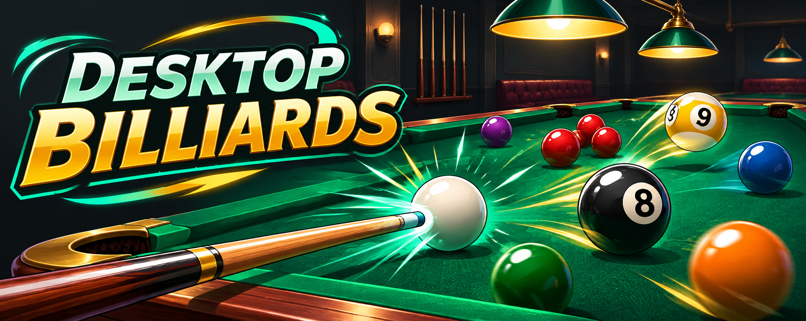

# Desktop Billiards

[简体中文](README.md) · [English](README.en.md) · [日本語](README.ja.md) · [Français](README.fr.md) · [한국어](README.ko.md) · [Português](README.pt.md)



A 3D billiards game for Windows. Practice nine-ball on a tight-pocket table, Chinese eight-ball (Heyball), or snooker. You can also enter tournaments against four levels of computer opponents. The game interface is in Simplified Chinese.

**Floating window.** Open settings with `F1` on Windows to switch to an always-on-top window with proportional resizing. Play continues when you switch apps.

**Showcase mode.** Watch two high-level computer players compete in nine-ball, Heyball or snooker. Take over either side and hand it back to the computer at any time. Leaving the match discards its progress. Watching and taking over do not affect your game balance.

## Run locally

1. Use Windows 10/11 x64 with .NET Framework 4.6.2 or later and the [Microsoft Edge WebView2 Evergreen Runtime](https://developer.microsoft.com/microsoft-edge/webview2/). To build from source, install [Node.js 24 LTS with npm](https://nodejs.org/en/download).
2. Clone the repository or extract **Code → Download ZIP** from GitHub. Open PowerShell in the project directory and run the commands below. The first build downloads npm packages and the WebView2 SDK.

   ```powershell
   npm.cmd ci
   npm.cmd run build
   ```

3. Open `release/DesktopBilliards.exe`, or run `Start-Process .\release\DesktopBilliards.exe`. Keep the DLLs and `web/` directory beside the executable when moving it. The desktop app runs without a Node server.

For a browser preview, run `npm.cmd run build:web` after installing dependencies. With Python 3 installed, run `python -m http.server 8000 --bind 127.0.0.1 --directory release/web` from the project root and open `http://127.0.0.1:8000` in a WebGL-capable browser. Wallpaper integration and native window controls are part of the Windows app.

## Controls

| Action | Default control |
| --- | --- |
| Walk around the table | `A` / `D` or right-drag. Scroll to adjust eye height |
| Place the cue ball | Click a legal position on the table or placement map. Confirm with `V` or the on-screen button |
| Aim or stand up | `Space` to take your stance, `O` to stand up |
| Aim and shoot | Move the mouse or use `←` / `→`. Pull back with the left mouse button or hold `F`, then release to shoot |
| Spin and settings | Click the cue-ball diagram for spin. `R` resets spin, `G` toggles the guide, `F1` opens settings, `Esc` goes back |

In practice, the coaching tool shows shot selection, position play and cushion escapes. Apply the suggested cue tip position or play the suggested shot as a demonstration. The lines stay visible after leaving the overhead view until the shot conditions change.

## Rules and tournaments

- **Nine-ball**. Hit the lowest-numbered ball first and legally pocket the 9 to win. Computer matches include the three-point break rule, push-outs and the three-foul rule. The lag determines the opening choice. Later racks use winner breaks or alternate breaks according to the event.
- **Heyball**. Clear your group of solids or stripes, then legally pocket the 8. Break fouls and re-racks follow the in-game referee. Lag for the first break, then alternate.
- **Snooker**. Alternate reds and colours, then clear yellow through black in order. Computer matches include foul points, concessions when snookers are required, re-spotted black and 147 breaks. Draw lots for the first frame, then alternate.
- **Tournaments**. The lowest level can enter the club event. The three higher levels can enter major events when eligible. Rack wins count toward the match score, and prize money is settled when the tournament ends. Event cards list the format, fees, prize funds and sources. The game uses simplified brackets and approximate physics.

Rule references are [WPA nine-ball](https://wpapool.com/rules/), [WPA Heyball](https://www.wpapool.com/wp-content/uploads/2025/08/250816-Rules-of-Heyball.pdf) and [WPBSA snooker](https://www.wpbsa.com/rules/).

## Starting balance and saves

**New players start with £250.00 in game funds**, with an empty loan, title and match history. All money is in-game only. Saves, balance and key bindings are stored in the local app profile. The repository contains the code and assets. Unfinished matches expire 72 hours after their last save.

## Development and credits

Run `npm.cmd test` for physics, rules, AI, tournaments and saves. After building, `npm.cmd run test:ui` runs the UI suite using locally installed Microsoft Edge. Game code is in `src/`, the Windows host in `native/`, build and asset scripts in `scripts/`, and tests in `tests/`.

Rendering uses Three.js and the Windows host uses Microsoft WebView2. See the [audio credits](assets/audio/CREDITS.txt) for recording authors and licences. The build includes third-party notices. The project source has no separate open-source licence declaration.
