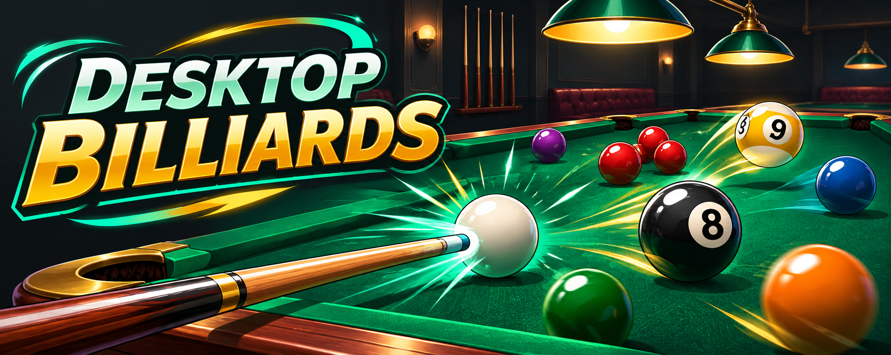

# Desktop Billiards

[简体中文](README.md) · [English](README.en.md) · [日本語](README.ja.md) · [Français](README.fr.md) · [한국어](README.ko.md) · [Português](README.pt.md)



Un jeu de billard en 3D pour Windows et macOS. Entraînez-vous au jeu de la 9 sur une table à poches étroites, au billard chinois à 8 billes (Heyball) ou au snooker. Vous pouvez aussi participer à des tournois contre quatre niveaux d’adversaires contrôlés par l’ordinateur. L’interface du jeu est en chinois simplifié.

**Fenêtre flottante.** Sous Windows, ouvrez les réglages avec `F1` pour afficher une fenêtre au premier plan que vous pouvez redimensionner en conservant ses proportions. La partie continue lorsque vous changez d’application.

**Mode spectateur (高手如云).** Regardez deux adversaires de niveau élevé disputer un tournoi de 9, de Heyball ou de snooker. Prenez le contrôle de l’un des deux camps et rendez-le à l’ordinateur à tout moment. La progression est effacée en quittant le match. Le solde de jeu reste intact.

## Téléchargement

- [Windows 10/11 x64](https://github.com/Barelooue/Desktop-Billiards/releases/download/v0.6.0/Desktop-Billiards-v0.6.0-Windows-x64.zip)
- [Mac · Apple Silicon (série M)](https://github.com/Barelooue/Desktop-Billiards/releases/download/v0.6.0/Desktop-Billiards-v0.6.0-macOS-arm64.zip)
- [Mac · Intel](https://github.com/Barelooue/Desktop-Billiards/releases/download/v0.6.0/Desktop-Billiards-v0.6.0-macOS-x64.zip)

Téléchargez le ZIP correspondant, décompressez-le, puis ouvrez `DesktopBilliards.exe` sous Windows ou `Desktop Billiards.app` sur Mac. Les versions Mac nécessitent macOS 13 ou ultérieur et sont en préversion sans notarisation Apple. [Installation et compilation sur Mac](mac/README.md)

## Jouer sur votre ordinateur

1. Utilisez Windows 10/11 x64 avec .NET Framework 4.6.2 ou ultérieur et le [runtime Microsoft Edge WebView2 Evergreen](https://developer.microsoft.com/microsoft-edge/webview2/). Pour compiler le projet, installez [Node.js 24 LTS avec npm](https://nodejs.org/en/download).
2. Clonez le dépôt ou décompressez l’archive obtenue via **Code → Download ZIP**. Ouvrez PowerShell à la racine du projet. La première compilation télécharge les dépendances npm et le SDK WebView2.

   ```powershell
   npm.cmd ci
   npm.cmd run build
   ```

3. Lancez `release/DesktopBilliards.exe`. Si vous déplacez le jeu, conservez les DLL et le dossier `web/` à côté de l’exécutable. Le jeu de bureau fonctionne sans serveur Node.

Pour un aperçu dans le navigateur, lancez `npm.cmd run build:web`. Avec Python 3, exécutez `python -m http.server 8000 --bind 127.0.0.1 --directory release/web`, puis ouvrez `http://127.0.0.1:8000` dans un navigateur compatible WebGL. L’intégration du fond d’écran et les commandes de fenêtre natives sont propres à la version Windows.

## Commandes

| Action | Commande par défaut |
| --- | --- |
| Faire le tour de la table | `A` / `D` ou glisser avec le bouton droit. La molette règle la hauteur du regard |
| Placer la bille blanche | Cliquez dans la zone autorisée sur la table ou le plan, puis confirmez avec `V` ou le bouton |
| Se mettre en position | `Espace` pour se pencher, `O` pour se relever |
| Viser et jouer | Souris ou `←` / `→` pour viser. Tirez la queue avec le bouton gauche ou maintenez `F`, puis relâchez |
| Effets et réglages | Choisissez le point d’impact sur le schéma. `R` recentre, `G` active le guide, `F1` ouvre les réglages et `Esc` revient en arrière |

En entraînement, le guide indique la bille à jouer, le point d’impact, la puissance, le placement de la blanche et les trajectoires par les bandes. Vous pouvez appliquer le point d’impact ou lancer le coup de démonstration.

## Règles et tournois

- **Jeu de la 9**. Touchez d’abord la bille au numéro le plus bas. Empochez légalement la 9 pour gagner. Les matchs incluent la règle des trois points à la casse, le push-out et la défaite après trois fautes consécutives. Le tir à la bande décide de la première casse, puis le vainqueur casse ou les joueurs alternent selon le tournoi.
- **Heyball**. Empochez toutes les billes de votre groupe puis la 8 légalement. Les fautes à la casse et la remise en triangle suivent l’arbitrage du jeu. La première casse se décide par tir à la bande, les suivantes alternent.
- **Snooker**. Alternez rouges et couleurs, puis empochez jaune, verte, marron, bleue, rose et noire dans l’ordre. Les matchs prennent en compte les points de faute, la concession, la noire replacée en cas d’égalité et les breaks de 147. Le premier départ est tiré au sort, puis alterne.
- **Tournois**. Le niveau le plus bas donne accès au tournoi du club. Les trois niveaux supérieurs peuvent entrer dans les grandes épreuves si les conditions sont remplies. Les victoires par manche comptent au score du match. Les gains sont versés à la fin du tournoi. Le jeu simplifie les tableaux et simule la physique du billard.

[Règles WPA](https://wpapool.com/rules/) · [Règles WPBSA](https://www.wpbsa.com/rules/)

## Solde initial et sauvegardes

**Chaque nouveau joueur commence avec 250,00 £ de monnaie de jeu**, sans emprunt ni historique de titres ou de matchs. Le solde, les sauvegardes et les raccourcis sont stockés localement. Les parties inachevées expirent 72 heures après leur dernière sauvegarde.

## Développement et crédits

Lancez `npm.cmd test` pour les tests automatisés. Après compilation, `npm.cmd run test:ui` utilise Microsoft Edge installé localement. `src/` contient le jeu, `native/` l’application hôte, `scripts/` les outils de compilation et `tests/` les tests. Le rendu utilise Three.js et l’hôte Windows utilise Microsoft WebView2. Consultez les [crédits audio](assets/audio/CREDITS.txt) pour les auteurs et licences. Le code du projet ne déclare pas de licence open source distincte.
