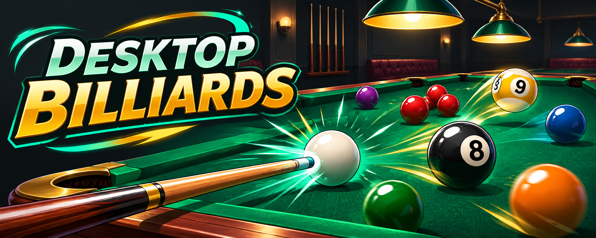

# Desktop Billiards

[简体中文](README.md) · [English](README.en.md) · [日本語](README.ja.md) · [Français](README.fr.md) · [한국어](README.ko.md) · [Português](README.pt.md)



Windows 向けの 3D ビリヤードゲームです。ポケットの狭い台でのナインボール、中国式エイトボール（Heyball）、スヌーカーを練習できます。4 段階のコンピューター対戦と大会もあります。ゲーム画面は簡体字中国語です。

**フローティングウィンドウ。** Windows 版では `F1` の設定から、縦横比を保って拡大縮小できる最前面ウィンドウに切り替えられます。他のアプリに切り替えても対戦は続きます。

**観戦モード（高手如云）。** ナインボール、Heyball、スヌーカーで上級コンピューター同士の大会を観戦できます。どちらの側でも操作を引き継ぎ、コンピューターに戻せます。対戦を離れると進行は破棄され、ゲーム内残高には影響しません。

## ローカルでの起動

1. Windows 10/11 x64、.NET Framework 4.6.2 以降、[Microsoft Edge WebView2 Evergreen Runtime](https://developer.microsoft.com/microsoft-edge/webview2/) を用意します。ソースからのビルドには [Node.js 24 LTS（npm を含む）](https://nodejs.org/en/download) が必要です。
2. リポジトリをクローンするか、GitHub の **Code → Download ZIP** でダウンロードして展開します。プロジェクトのルートで PowerShell を開いて実行します。初回は npm パッケージと WebView2 SDK の取得にインターネット接続が必要です。

   ```powershell
   npm.cmd ci
   npm.cmd run build
   ```

3. `release/DesktopBilliards.exe` を起動します。別の場所へ移動する場合は DLL と `web/` も同じフォルダーに置いてください。通常のプレイに Node サーバーは不要です。

ブラウザーで試すには `npm.cmd run build:web` を実行します。Python 3 があれば `python -m http.server 8000 --bind 127.0.0.1 --directory release/web` で配信し、WebGL 対応ブラウザーで `http://127.0.0.1:8000` を開けます。壁紙連携とネイティブウィンドウは Windows 版の機能です。

## 操作

| 操作 | 初期設定 |
| --- | --- |
| 台の周囲を移動 | `A` / `D` または右ドラッグ。ホイールで視点の高さを調整 |
| 手球を置く | 台または配置図の有効範囲をクリックし、`V` または画面のボタンで確定 |
| 構える・立つ | `Space` で構え、`O` で立つ |
| 狙う・撞く | マウスまたは `←` / `→` で狙い、左ドラッグまたは `F` の長押しで力をため、離して撞く |
| 回転・設定 | 手球の図で撞点を指定。`R` で中央、`G` でガイド切替、`F1` で設定、`Esc` で戻る |

練習ガイドでは、狙い球、撞点、力加減、手球のポジションやクッションを使った脱出経路を確認できます。撞点だけを適用したり、お手本のショットを再現したりできます。

## ルールと大会

- **ナインボール**。最小番号の球に先に当て、9 番を合法的に入れると勝ちです。対戦ではスリーポイントルール、プッシュアウト、連続 3 ファウルを扱います。初回はバンキングで決め、その後は大会に応じて勝者ブレイクまたは交互ブレイクです。
- **Heyball**。自分のグループをすべて入れてから 8 番を合法的に入れます。ブレイク後の処置はゲーム内の裁定に従います。初回はバンキング、その後は交互です。
- **スヌーカー**。赤とカラーを交互に入れ、赤がなくなったら黄、緑、茶、青、ピンク、黒の順に入れます。ファウルの加点、コンシード、同点時の黒の再配置、147 ブレイクを扱います。先攻は抽選し、以降は交互です。
- **大会**。最低難度はクラブ大会に参加できます。上位 3 難度では条件を満たすと主要大会に参加できます。勝ったラックやフレームを対戦スコアに加え、賞金は大会終了時に精算します。大会の進行と物理挙動はゲーム向けに近似しています。

[WPA ルール](https://wpapool.com/rules/) · [WPBSA ルール](https://www.wpbsa.com/rules/)

## 初期資金とセーブ

**新規プレイヤーはゲーム内資金 £250.00** から始めます。借入、優勝、対戦の履歴は空です。セーブや残高、キー設定はローカルに保存されます。未完了の対戦は最終保存から 72 時間で削除されます。

## 開発とクレジット

`npm.cmd test` でテストを実行できます。ビルド後は、ローカルの Microsoft Edge を使って `npm.cmd run test:ui` を実行できます。`src/` はゲーム、`native/` は Windows ホスト、`scripts/` はビルドツール、`tests/` はテストです。描画には Three.js、Windows ホストには Microsoft WebView2 を使用しています。[音源とライセンス](assets/audio/CREDITS.txt)を参照してください。プロジェクト本体のオープンソースライセンスは別途宣言されていません。
