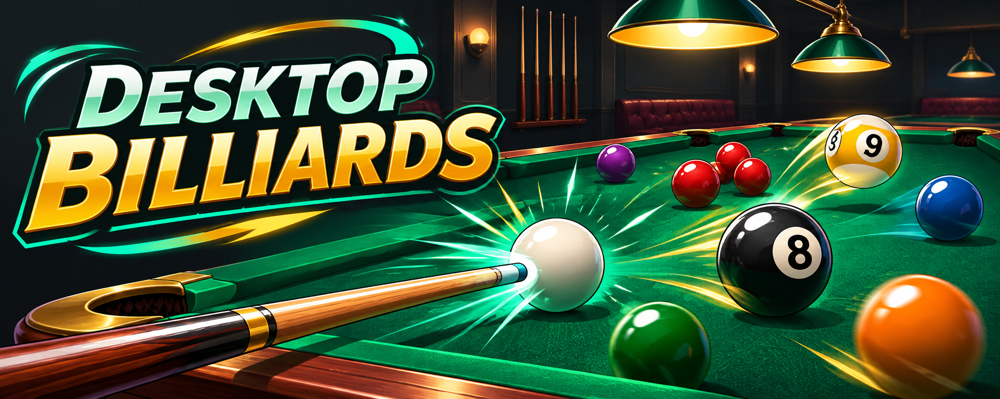

# Desktop Billiards

[简体中文](README.md) · [English](README.en.md) · [日本語](README.ja.md) · [Français](README.fr.md) · [한국어](README.ko.md) · [Português](README.pt.md)



Windows용 3D 당구 게임입니다. 포켓이 좁은 테이블에서 9볼, 중국식 8볼(Heyball), 스누커를 연습하거나 네 가지 난이도의 컴퓨터를 상대로 대회에 참가할 수 있습니다. 게임 화면은 중국어 간체로 표시됩니다.

**플로팅 창.** Windows에서 `F1`로 설정을 열어 화면 비율을 유지하는 항상 위 창으로 전환할 수 있습니다. 다른 앱으로 전환해도 경기는 계속됩니다.

**관전 모드(高手如云).** 9볼, Heyball, 스누커 대회에서 상급 컴퓨터 플레이어 두 명의 경기를 볼 수 있습니다. 어느 쪽이든 직접 조작한 뒤 다시 컴퓨터에 맡길 수 있습니다. 경기를 나가면 진행 상황이 사라지며 게임 자금에는 영향이 없습니다.

## 내 컴퓨터에서 실행

1. Windows 10/11 x64, .NET Framework 4.6.2 이상, [Microsoft Edge WebView2 Evergreen Runtime](https://developer.microsoft.com/microsoft-edge/webview2/)이 필요합니다. 소스에서 빌드하려면 [Node.js 24 LTS와 npm](https://nodejs.org/en/download)을 설치하세요.
2. 저장소를 복제하거나 GitHub에서 **Code → Download ZIP**을 선택하고 압축을 풉니다. 프로젝트 루트에서 PowerShell을 열고 아래 명령을 실행하세요. 첫 빌드에는 npm 패키지와 WebView2 SDK를 내려받기 위한 인터넷 연결이 필요합니다.

   ```powershell
   npm.cmd ci
   npm.cmd run build
   ```

3. `release/DesktopBilliards.exe`를 실행합니다. 게임을 옮길 때 실행 파일과 DLL 및 `web/` 폴더를 함께 옮기세요. 데스크톱 버전은 Node 서버 없이 실행됩니다.

브라우저에서 미리 보려면 `npm.cmd run build:web`을 실행하세요. Python 3가 설치되어 있다면 `python -m http.server 8000 --bind 127.0.0.1 --directory release/web`을 실행한 후 WebGL을 지원하는 브라우저에서 `http://127.0.0.1:8000`을 여세요. 바탕 화면과 연동되는 기능과 네이티브 창은 Windows 버전에서 사용할 수 있습니다.

## 조작

| 동작 | 기본 조작 |
| --- | --- |
| 테이블 둘러보기 | `A` / `D` 또는 마우스 오른쪽 버튼으로 드래그. 휠로 시점 높이 조절 |
| 수구 배치 | 테이블이나 배치 그림에서 허용 위치를 클릭하고 `V` 또는 화면 버튼으로 확인 |
| 자세 전환 | `Space`로 자세를 낮추고 `O`로 일어서기 |
| 조준과 샷 | 마우스 또는 `←` / `→`로 조준. 왼쪽 버튼을 누른 채 당기거나 `F`를 길게 누른 후 놓아 치기 |
| 회전과 설정 | 수구 그림에서 타점을 선택. `R`은 타점 초기화, `G`는 가이드 전환, `F1`은 설정, `Esc`는 뒤로 가기 |

연습의 가이드에서 추천 공, 타점, 세기, 수구 위치와 쿠션을 이용한 탈출 경로를 볼 수 있습니다. 타점만 적용하거나 추천 샷을 시연할 수 있습니다.

## 규칙과 대회

- **9볼**. 번호가 가장 낮은 공을 먼저 맞히고 9번 공을 합법적으로 넣으면 승리합니다. 대전에는 브레이크의 3점 규칙, 푸시 아웃, 3회 연속 파울 패배가 적용됩니다. 첫 브레이크는 래그로 정하고 이후에는 대회에 따라 승자 브레이크 또는 교대 브레이크를 적용합니다.
- **Heyball**. 자신의 그룹을 모두 넣고 8번 공을 합법적으로 넣으면 승리합니다. 브레이크 파울과 재배치는 게임 내 판정에 따릅니다. 첫 브레이크는 래그로 정하고 이후에는 교대합니다.
- **스누커**. 적구와 컬러볼을 번갈아 넣고, 적구가 없으면 노랑, 초록, 갈색, 파랑, 분홍, 검정 순으로 넣습니다. 파울 점수, 기권, 동점 시 검정 공 재배치와 147 브레이크를 지원합니다. 첫 프레임 선공은 추첨하고 이후에는 교대합니다.
- **대회**. 가장 낮은 난이도에서는 클럽 대회에 참가할 수 있습니다. 상위 세 난이도는 참가 조건을 충족하면 주요 대회에 출전할 수 있습니다. 각 랙이나 프레임 승리가 경기 점수에 반영되며 상금은 대회 종료 후 정산합니다. 대진과 물리 모델은 게임에 맞게 단순화했습니다.

[WPA 규칙](https://wpapool.com/rules/) · [WPBSA 규칙](https://www.wpbsa.com/rules/)

## 초기 자금과 저장

**새 플레이어는 게임 자금 £250.00으로 시작**하며 대출, 우승, 경기 기록은 비어 있습니다. 잔액, 저장 파일과 단축키는 컴퓨터의 앱 프로필에 저장됩니다. 미완료 경기는 마지막 저장 후 72시간이 지나면 삭제됩니다.

## 개발과 크레딧

`npm.cmd test`로 자동 테스트를 실행합니다. 빌드 후에는 설치된 Microsoft Edge를 사용하는 `npm.cmd run test:ui`도 실행할 수 있습니다. `src/`는 게임 코드, `native/`는 Windows 호스트, `scripts/`는 빌드 도구, `tests/`는 테스트입니다. 렌더링에는 Three.js, Windows 호스트에는 Microsoft WebView2를 사용합니다. 녹음 저작자와 라이선스는 [오디오 크레딧](assets/audio/CREDITS.txt)에서 확인할 수 있습니다. 프로젝트 코드의 별도 오픈 소스 라이선스는 명시되어 있지 않습니다.
