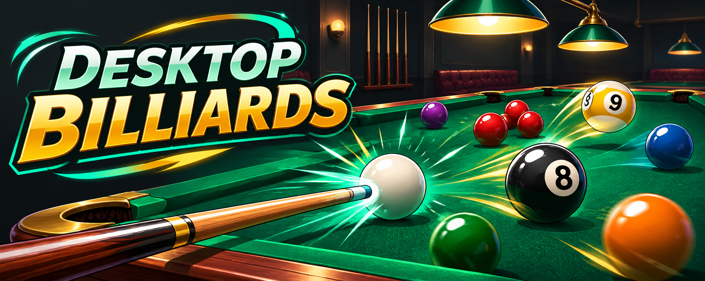

# 一个人的台球 · Desktop Billiards

[简体中文](README.md) · [English](README.en.md) · [日本語](README.ja.md) · [Français](README.fr.md) · [한국어](README.ko.md) · [Português](README.pt.md)



一个支持 Windows 和 macOS 的 3D 台球游戏。可以在窄袋台上练习九球、中式八球和斯诺克，也可以报名与四档电脑对手比赛。游戏界面为简体中文，上方链接切换的是项目文档。

**悬浮窗**。Windows 版按 `F1` 进入设置，可开启置顶、等比缩放的悬浮窗。切换到其他应用时对局继续。

**高手如云**。九球、中式八球和斯诺克均支持双高档人机观赛。选择赛事后可随时接管甲方或乙方，再交还电脑。进度只保留到离开这场比赛，观赛和接管不影响游戏资金。

## 下载

- [Windows 10/11 x64](https://github.com/Barelooue/Desktop-Billiards/releases/download/v0.7.0/Desktop-Billiards-v0.7.0-Windows-x64.zip)
- [Mac · Apple Silicon（M 系列）](https://github.com/Barelooue/Desktop-Billiards/releases/download/v0.7.0/Desktop-Billiards-v0.7.0-macOS-arm64.zip)
- [Mac · Intel](https://github.com/Barelooue/Desktop-Billiards/releases/download/v0.7.0/Desktop-Billiards-v0.7.0-macOS-x64.zip)

点击对应版本下载 ZIP，解压后打开 Windows 的 `DesktopBilliards.exe` 或 Mac 的 `Desktop Billiards.app`。Mac 版要求 macOS 13 或更新版本，目前为未公证预览版。 [Mac 运行及构建说明](mac/README.md)

## 在自己的电脑上运行

1. 准备 Windows 10/11 x64、.NET Framework 4.6.2 或更新版本，以及 [Microsoft Edge WebView2 Evergreen Runtime](https://developer.microsoft.com/microsoft-edge/webview2/)。从源码构建还需要 [Node.js 24 LTS（含 npm）](https://nodejs.org/en/download)。
2. 在 GitHub 选择 **Code → Download ZIP** 并解压，或用 Git 克隆仓库。在项目根目录打开 PowerShell，运行以下命令。首次构建需要联网下载 npm 依赖和 WebView2 SDK。

   ```powershell
   npm.cmd ci
   npm.cmd run build
   ```

3. 双击 `release/DesktopBilliards.exe`，或在 PowerShell 运行 `Start-Process .\release\DesktopBilliards.exe`。移动游戏时请保留 `release/` 内的 DLL 和 `web/` 目录。日常运行无需 Node 服务。

只想在浏览器试玩，可以在安装依赖后运行 `npm.cmd run build:web`。如果电脑装了 Python 3，在项目根目录运行 `python -m http.server 8000 --bind 127.0.0.1 --directory release/web`，再用支持 WebGL 的浏览器打开 `http://127.0.0.1:8000`。Windows 版提供桌面壁纸和原生窗口功能。

## 上手操作

| 操作 | 默认控制 |
| --- | --- |
| 绕台观察 | `A` / `D` 或按住鼠标右键拖动，滚轮调观察高度 |
| 摆放母球 | 点击合法台面或摆位图，`V` 或按钮确认 |
| 俯身与起身 | `Space` 俯身，`O` 起身 |
| 瞄准与出杆 | 移动鼠标或按 `←` / `→` 调杆，左键下拉后松手或按住 `F` 再松手出杆 |
| 杆法与设置 | 点击击球点选高低杆和左右塞，`R` 归中，`G` 切换辅助线，`F1` 暂停 / 设置，`Esc` 返回 |

练习中可点击「指导」，查看进攻、走位或碰库解球路线。可以只应用击球点，也可以按指导参数演示一杆。退出指导后，球路仍会保留到球位或击球条件改变。

## 比赛和规则

- **九球**。先碰台面号码最小的球，合法打进 9 号球获胜。人机赛包含三球开球条款、推杆和三次连续犯规负局。首局比球，后续按赛事采用胜者开球或轮流开球。
- **中式八球（Heyball）**。分全色和花色，清完本组后合法打进黑八获胜。开球后的判罚和重开选项按当前裁判规则处理。首局比球，之后轮流开球。
- **斯诺克**。红彩交替，红球打完后按黄、绿、棕、蓝、粉、黑清彩。人机赛含罚分、超分认输、最后黑球同分复位和单杆 147。首局抽签，之后轮流开球。
- **赛事**。低档开放球房周赛，中档、高档和巅峰球星可参加符合资格的大型赛事。比赛按局计大比分，晋级按轮记录，奖金在赛事结束时结算。赛事卡片标注资料来源、费用、赛制和已录入的奖金。游戏采用简化赛程及近似台球物理。

规则参考 [WPA 九球](https://wpapool.com/rules/)、[WPA Heyball](https://www.wpapool.com/wp-content/uploads/2025/08/250816-Rules-of-Heyball.pdf) 和 [WPBSA 斯诺克](https://www.wpbsa.com/rules/)。

## 初始资金与存档

**新玩家从 £250.00 游戏资金开始**，无贷款、冠军或球局记录。资金与奖金仅用于游戏。存档、余额和按键保存在本机应用配置，克隆仓库会取得源码和素材。未完成球局在最后一次保存后 72 小时自动清理。

## 开发与素材

`npm.cmd test` 运行物理、裁判、人机、赛事和存档测试。构建后可以用 `npm.cmd run test:ui` 在本机 Microsoft Edge 运行界面测试。`src/` 放游戏代码，`native/` 放 Windows 启动器，`scripts/` 放构建与素材处理脚本，`tests/` 放测试。

渲染使用 Three.js，Windows 端使用 Microsoft WebView2。音效作者和许可见 [音效来源](assets/audio/CREDITS.txt)。第三方许可随构建生成，项目源码目前没有单独声明开源许可。
